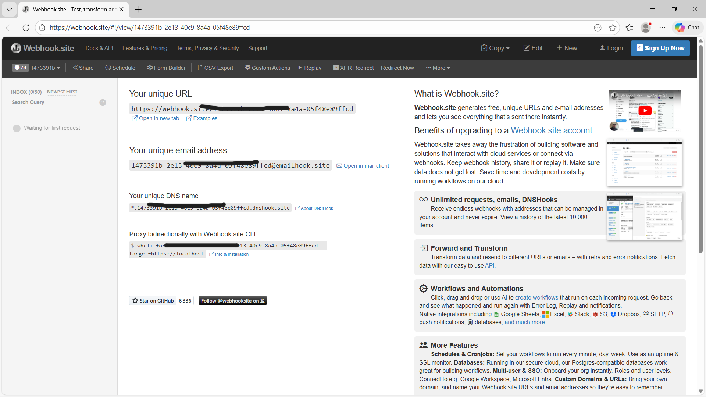
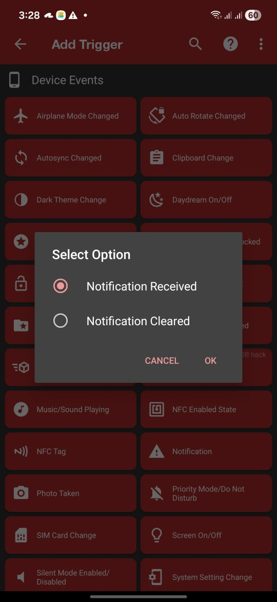
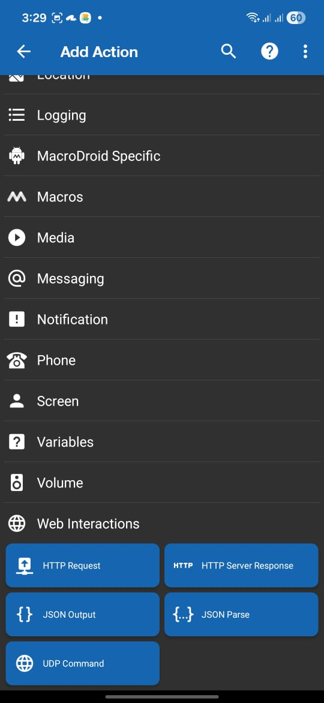
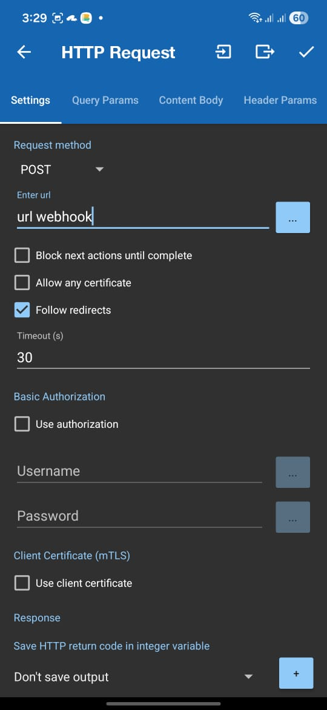
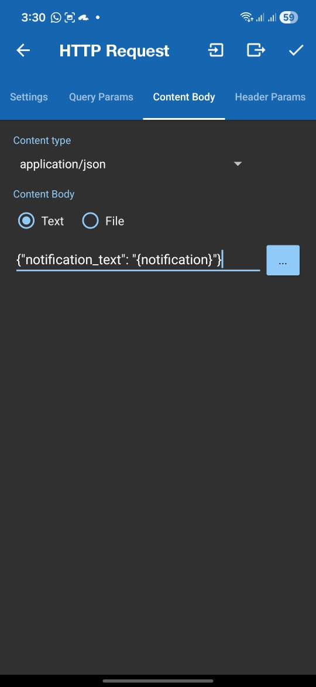
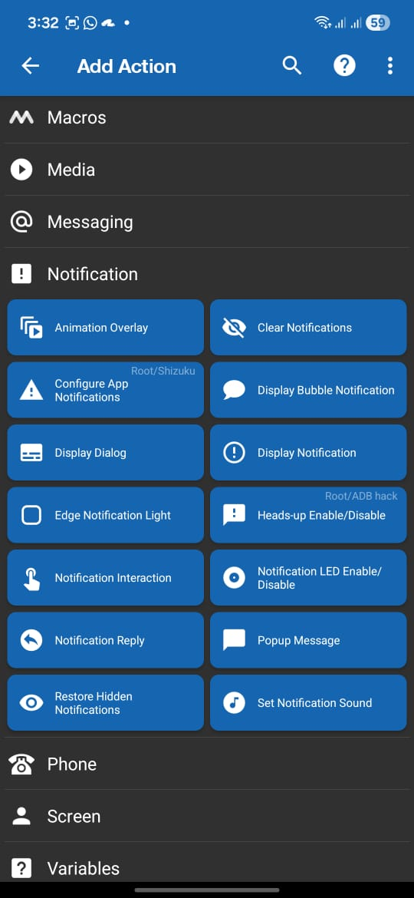
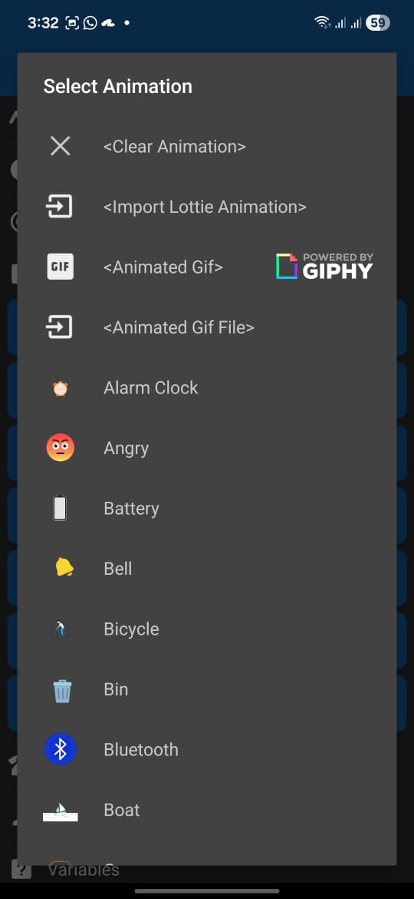
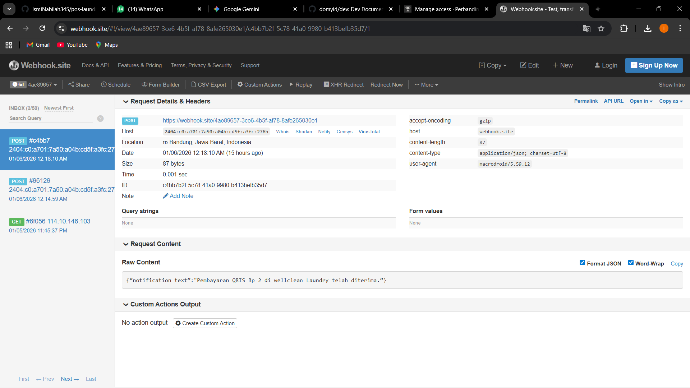

# INTEGRASI NOTIFIKASI PEMBAYARAN (ANDROID KE SERVER)
---

Dokumentasi ini menjelaskan proses integrasi otomatisasi notifikasi pembayaran dari perangkat Android ke server backend Sistem POS WellClean Laundry. Tujuannya adalah untuk mendeteksi transaksi masuk secara *real-time* tanpa perlu pengecekan manual.

## 1. Sumber Data (GoPay Merchant)
---
Proses dimulai dari transaksi pelanggan menggunakan QRIS yang terhubung dengan akun GoPay Merchant usaha. Sistem ini memanfaatkan notifikasi real-time yang dikirimkan oleh aplikasi GoPay Merchant setiap kali transaksi pembayaran via QRIS berhasil dilakukan oleh pelanggan. Pastikan sudah membuat akun GoPay Merchant.

## 2. Identifikasi Endpoint (Webhook.site)
---
Langkah awal teknis adalah menyiapkan endpoint sementara untuk memvalidasi paket data sebelum diteruskan ke server lokal.
Buka Webhook.site , lalu salin URL unik yang tertera.

Penggunaan Webhook.site berfungsi sebagai gateway pengujian untuk memvalidasi struktur data JSON/HTTP Request yang dikirim oleh perangkat mobile secara real-time.

## 3. Konfigurasi Trigger MacroDroid (Intersepsi Notifikasi)
---
Tahap ini menentukan kejadian apa yang memicu pengiriman data ke server. Pertama membuat Macro baru, lalu tambahkan Trigger "Notification Received".

!(trigger2.jpeg)

!(trigger3.jpeg)

MacroDroid dikonfigurasi untuk memantau notifikasi masuk secara spesifik dari aplikasi GoPay Merchant. Variabel teks dalam notifikasi tersebut (seperti nominal dan status) akan ditangkap untuk diproses lebih lanjut.

## 4. Konfigurasi Action HTTP Request
---
Tahap ini adalah "jembatan" yang mengirimkan data dari perangkat Android ke internet. Tambahkan Action "HTTP Request", pilih metode POST.

Detail pembayaran yang ditangkap oleh MacroDroid dikirimkan menggunakan metode HTTP POST. Data diarahkan ke URL endpoint dengan membawa isi pesan asli notifikasi agar dapat diparsing oleh backend.

## 5. Pengujian dan Validasi Data
---
Tahap final untuk membuktikan konektivitas antara GoPay Merchant dan sistem. Melakukan simulasi transaksi atau "Test Action" pada MacroDroid.

Berdasarkan hasil pengujian, notifikasi GoPay Merchant berhasil diteruskan oleh MacroDroid ke endpoint tujuan secara instan. Webhook.site menampilkan log permintaan masuk dengan status 200 OK, yang menandakan alur integrasi dari aplikasi merchant ke server telah berjalan sukses.